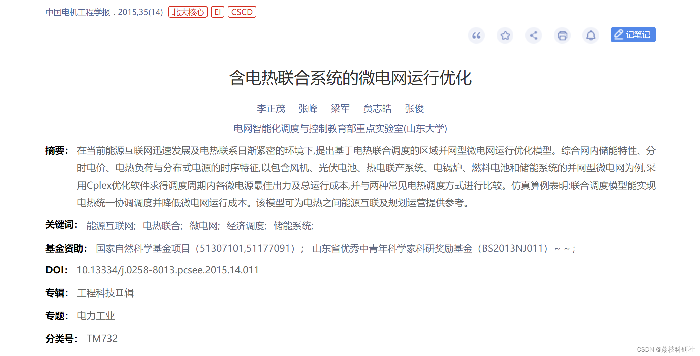
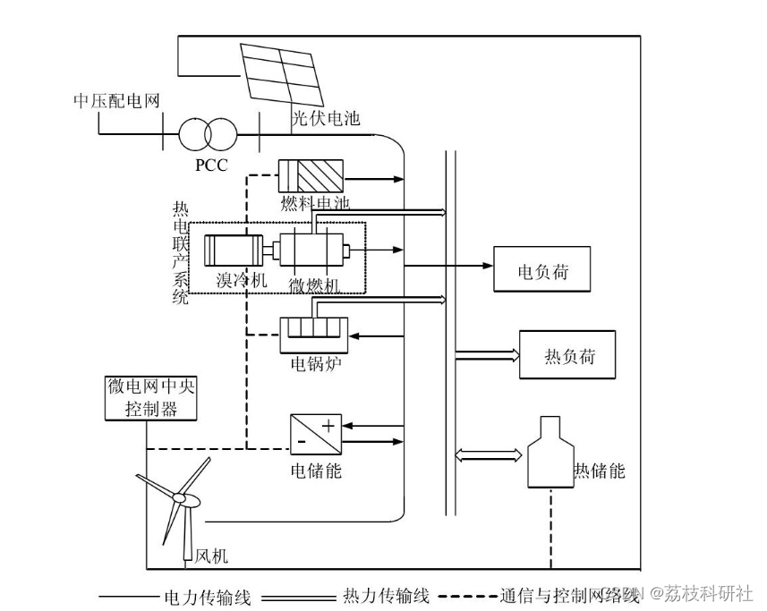
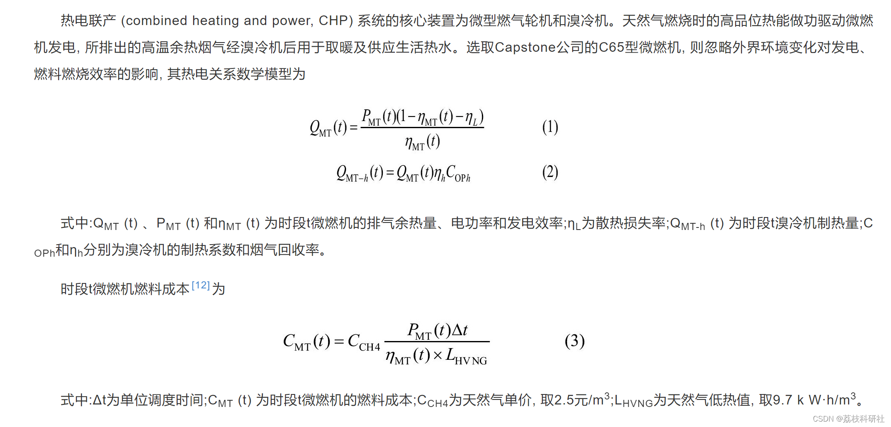
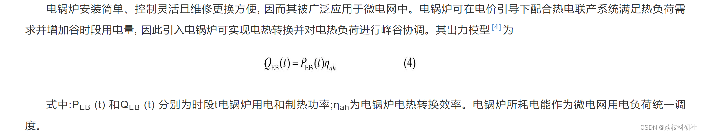
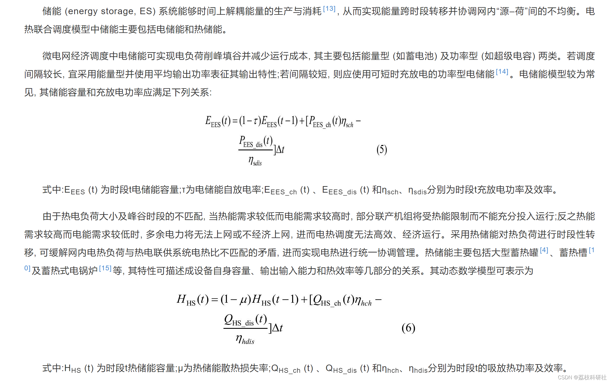
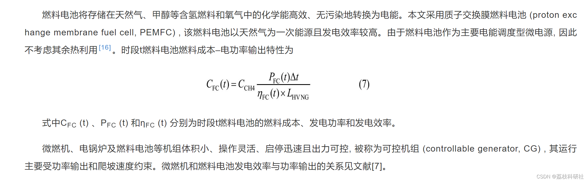
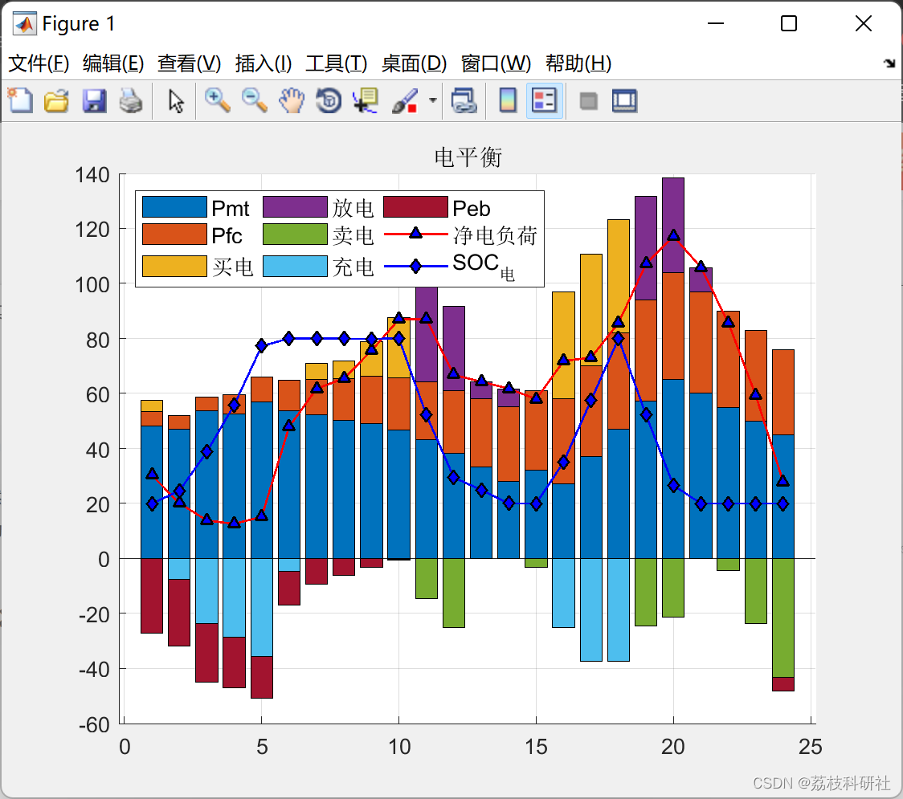
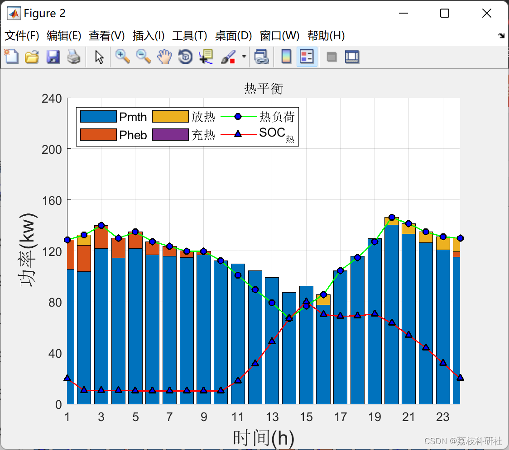

# Microgrid Operation Optimization with Integrated Electrical Heating System (Matlab Code Implementation)

​  
Editor
With the adjustment of the social energy structure, the development of the power system, and the increasingly mature storage technology, batteries and supercapacitors, among other electrical energy storage devices, are extensively applied in power systems to enhance the penetration rate of new energy sources and achieve peak shaving and valley filling. Essentially, all forms of energy (such as electric energy, thermal energy, and mechanical energy) can be stored, but currently, the application of energy storage in power systems is limited to electricity storage, i.e., converting electric energy into other forms of energy and then converting it back into electricity when needed for recharging into the power system. Therefore, the application of energy storage in power systems has significantly restricted the scope of use for energy storage technologies. Meanwhile, supply systems such as power systems, thermal systems, and gas systems, which currently operate independently with each system planning, designing, and solving problems on its own, lack coordination between them, which is not conducive to achieving clean, efficient, and reliable goals from a societal perspective.
In August 2013, the State Grid actively advocated a new energy consumption model of "substituting coal with electricity, oil with electricity, and electricity from afar". Meanwhile, as the development of the energy internet and the level of electrification increase, the proportion of electrical energy converted into thermal energy will continue to grow [2.·3]. The connection between electric and thermal systems will become increasingly close. Considering the complementary characteristics of electrical energy's "easy transmission, difficult storage" and thermal energy's "easily stored, difficult transmission", adding energy storage and electric-to-thermal conversion units between the regional microgrid's electric and thermal systems can better match the peak-valley characteristics of renewable energy output and electric-thermal load, thereby overall enhancing the controllability of the energy system.
1.1 Typical Microgrid Structure
The structure and energy flow of the combined electric and thermal dispatched microgrid are shown in Figure 1. The main components within the grid include wind turbines (WT), photovoltaic cells (PV), micro turbines (MT), electric boilers (EB), fuel cells (FC), electrical energy storage (EES), and thermal energy storage (HS). The medium voltage distribution network has a voltage of 10 kV, while the microgrid operates at a voltage of 0.38 kV. The microgrid interacts with the distribution network through tie lines for electricity exchange, and all units within the grid are controlled and communicated by the microgrid central controller (MGCC).

Edit:
1.2 Heat-electricity cogeneration system edit
1.3 Electric boiler edit
1.4 Energy system edit
1.5 Fuel cell edit📚2 Operational Results edit

Optimization results:
1) In mode 1, the microgrid's electric heating load is independently scheduled without affecting each other. Due to the higher cost of gas boiler heating compared to heat-electricity cogeneration systems, and the lack of utilization of the waste heat from the micro turbines in electricity dispatching (Figure A1 Table A1, Period 14), the cost of electric heating dispatching in mode 1 is relatively high.
2) In mode 2, the microgrid's electric heating loads are interconnected through the heat-electricity cogeneration system. The "heat-based electricity" approach of the cogeneration system can utilize waste heat more effectively than gas boiler heating, resulting in higher overall efficiency. Therefore, its cost is lower than mode 1. However, under this semi-autonomous electric heating dispatching method, the electric output of the micro turbines and electric boilers are limited by the thermal loads, preventing them from independently participating in the electric load dispatching. This limits their cost advantages in the electricity dispatching process, leading to relatively high costs in this semi-autonomous electric heating dispatching method.
3) In Method 3, due to the introduction of thermal energy storage, the "thermal-to-electricity" coupling in the cogeneration system is decoupled. The limitations on the electrical output of micro-gas turbines and electric boilers are lifted. By simultaneously optimizing both the cost of power supply and heating, a unified objective function can be used to achieve this.
Part of the code:
% Electric boiler
Peb_min = 0;  
Peb_max = 50;  
Reb_down = -3;  
Reb_up = 5;  
eta_ah = 0.85; % Thermal to electrical conversion efficiency
Cm_eb = 0.016;  
Cst_eb = 2.74;  
% Fuel cell
Pfc_min = 5;  
Pfc_max = 40;  
Rfc_down = -2;  
Rfc_up = 2;  
Cm_fc = 0.026;  
eta_fc = [0.633102762,0.630810014,0.626210435,0.622515243,0.619496279,0.615849659,0.614475289,0.609895576,0.606003752,0.602201083,0.599696666,0.595793234,0.595413236,0.593021958,0.595233072,0.599833088,0.604433107,0.60902944,0.613626799,0.618226815,0.62282674,0.627426773,0.632026849,0.636626883];  
Cst_fc = 1.2;  
% Electric energy storage
tau_b = 0.001;  
eta_bch = 0.9;  
eta_bdis = 0.9;  
Eb_init = 30;  
Eb_min = 0.2*150;  
Eb_max = 0.8*150;  
Cm_Eb = 0.0018;  
Pbch_min=0;% Electric energy storage charging
Pbch_max=37.5;  
Pbdis_min=0;% Electric energy storage discharge
Pbdis_max=37.5;  
% Thermal energy storage
tau_h = 0.01;  
eta_hch = 0.9;  
eta_hdis = 0.9;  
Eh_init = 0.2*100;  
Eh_min = 0.1*100;  
Eh_max = 0.8*100;  
Cm_Eh = 0.0016;  
Phch_min=0;% Thermal energy storage heat
Phch_max=25;  
Phdis_min=0;% Thermal energy storage heat release
Phdis_max=25;  
% Unit price coefficient
Cgas = 2.5;  
L_gas = 9.7;  
Uinit = 0;  
Che = 0.1; % Heat production coefficient
🎉3 References
🌈4 Matlab code implementation

## Images

<!-- PAYMENT_BLOCK -->

## Get this dataset

- Payment link (Stripe): [Buy now](https://buy.stripe.com/3cs8yP7sY87d0vu9AB)
- Payment QR code: 

<!-- /PAYMENT_BLOCK -->
